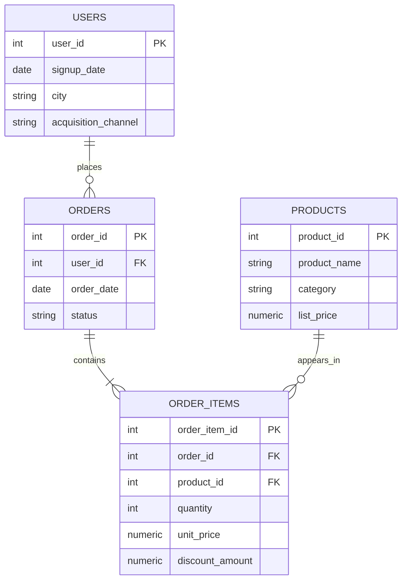

# ShopSmart | E-commerce Product Analytics with SQL & Power BI

A portfolio project using PostgreSQL and Power BI to investigate e-commerce product performance, customer purchasing behaviour, order outcomes, and revenue trends.

The project demonstrates how a product or business analyst can turn structured data into clearly defined metrics, evidence-based findings, and practical recommendations.

> **Project status:** The first synthetic dataset has been retired from business analysis after a data-quality issue was identified: all orders referenced the same product, making product- and category-level comparisons unreliable. I am rebuilding the dataset before continuing with the main analyses. Earlier SQL files are retained as learning exercises, not as validated business findings.

## Business scenario

ShopSmart is a fictional Indian B2C e-commerce business. The goal is to answer questions that could help a product or business team understand what is selling, how customers purchase, and how performance changes over time.

All data used in this project is synthetic. It does not represent a real company or real customers.

## Questions this project will investigate

Once the replacement dataset has been validated, the analysis will focus on:

1. **Product and category performance**
   - Which products and categories generate the most revenue?
   - Which products sell the most units?
   - How does performance vary across categories?

2. **Orders and revenue**
   - How many orders are completed, cancelled, returned, or pending?
   - What is the average order value (AOV)?
   - How do revenue and order volume change over time?

3. **Repeat purchasing**
   - How many customers place one order versus multiple orders?
   - What share of completed orders and revenue comes from repeat purchasers?
   - How much time passes between a customer's purchases?

4. **Trends over time**
   - How do monthly orders and revenue change?
   - Which product categories gain or lose share over time?
   - Are observed changes consistent across products and categories?

Metric definitions will specify the relevant order statuses and denominators. Revenue will not be treated as profit, and no acquisition-cost or return-on-ad-spend conclusions will be made without the required cost data.

## Dataset and data model

### Initial dataset — retired

The first version contained users, products, events, and orders. During validation, I found that every order referenced the same product. This prevented meaningful product and category comparisons, so I stopped using this version for portfolio-level conclusions.

The event records were also generated independently rather than as reliably ordered customer journeys. Therefore, I will not use them to claim funnel conversion or drop-off insights.

### Replacement dataset — in progress

The replacement dataset is being designed around four tables:

| Table | Purpose |
|---|---|
| users | Customer details such as signup date, city, and acquisition channel |
| products | Product names, categories, and list prices |
| orders | Customer orders, dates, and order statuses |
| order_items | Products and quantities within each order, including item-level price and discount information |

The order_items table allows an order to contain multiple products, supporting more reliable product-, category-, and order-level calculations.

### Planned entity relationship

This is the intended replacement model; treat it as a design until the dataset has been generated and validated in PostgreSQL.

## Repository structure

- problem_statements/ — business questions and analysis briefs
- sql_queries/ — SQL used to answer each question
- results/ — query outputs and supporting evidence
- README.md — project overview, data model, scope, and limitations

The initial files are retained to show the SQL learning process. Results from the retired dataset should not be interpreted as reliable business insights.

## SQL skills practised

The learning exercises have covered:

- SELECT, WHERE, and LIMIT
- Filtering with AND and OR
- Sorting with ORDER BY
- Removing duplicates with DISTINCT
- Grouping and aggregation for business metrics (as the project progresses)
- Joins and date-based analysis (planned for the replacement dataset)

## Tools

- **PostgreSQL** — data querying and analysis
- **pgAdmin 4** — database management and query execution
- **Power BI** — dashboarding and visualisation, planned after the data and metrics are validated

## Analysis workflow

For each business question, I will:

1. Define the business question and metric.
2. Check the data structure and quality needed to answer it.
3. Write and run the SQL query.
4. Validate the result, including joins, duplicates, nulls, and metric denominators where relevant.
5. Explain what the result does and does not support.
6. Translate the finding into a practical product or business implication.
7. Add the validated query and supporting output to the repository.

## Limitations and integrity

- ShopSmart and all records are fictional and synthetic.
- The retired dataset is not suitable for product- or category-level conclusions.
- No findings will be presented as real-world customer behaviour.
- Funnel analysis is excluded unless a future event dataset reliably captures ordered user journeys.
- Revenue, profit, customer acquisition cost, and advertising return are different measures; they will not be conflated.
- The replacement dataset and dashboard will be described as complete only after they have been generated, checked, and documented.

## Project goal

The aim is not just to write SQL queries. It is to demonstrate a repeatable analytical process: validate the data, define the metric, interpret the evidence carefully, and connect the result to a product or business decision.
